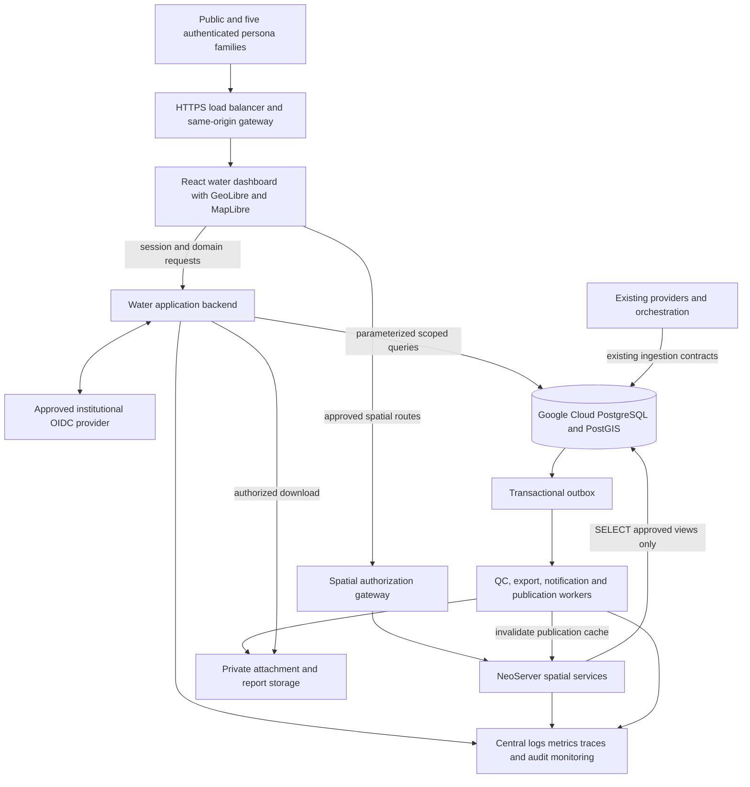
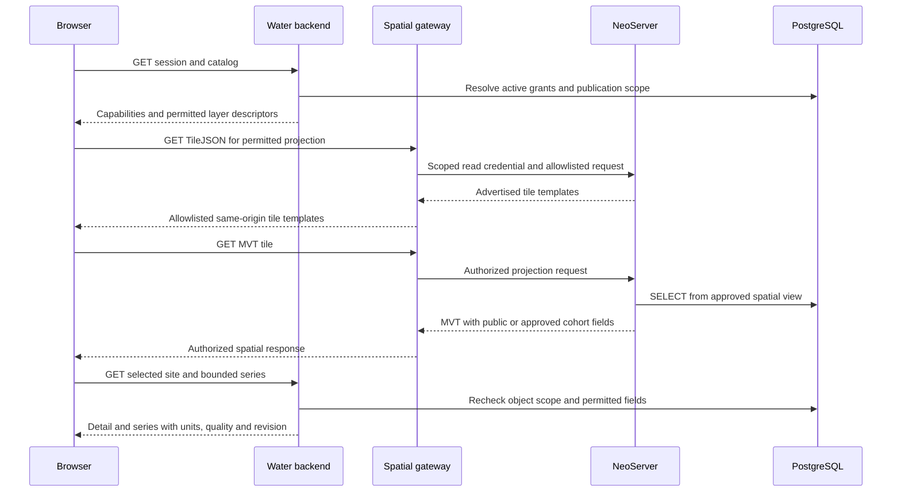
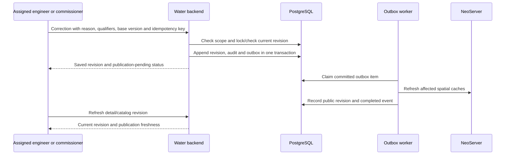

# Utah Water Measurement Dashboard Architecture

Version 1.1 | 21 October 2026 | Proposed architecture and decision record

The portal uses GeoLibre with MapLibre GL JS for maps, NeoServer for controlled spatial publication, and a water-domain backend for permissions and measurement workflows. The browser never connects to PostgreSQL. OGC SensorThings is excluded from the new dashboard's required stack; an existing source integration can keep an isolated adapter if needed.

## System context



The drawing shows logical responsibilities. The application backend and spatial gateway may share a deployment initially. Existing ingestion is a dependency to integrate; this project does not silently replace HydroServer, WCAT or provider pipelines.

## Trust and data publication boundaries

The public spatial projection includes only intentionally published station identifiers, geometry and approved descriptive attributes. PostgreSQL publication views remove private fields before NeoServer reads them. This protects MVT as well as GeoJSON: a hidden map label does not remove a property from downloaded tile bytes.

The browser authenticates to the application backend, which evaluates current business roles and scoped assignments. NeoServer workspace/layer roles protect the spatial publication service; they do not substitute for site, owner or organization authorization. Shared server-held credentials may read only a projection safe for every member of the receiving cohort. Private owner/site data uses a scoped backend query, not a browser-supplied owner filter. [NeoServer authentication](https://github.com/tobilg/neoserver/blob/main/docs/authentication.md), [SQL views](https://github.com/tobilg/neoserver/blob/main/docs/data-sources.md)

The gateway allowlists workspace, service, layer and operation, resolves the permitted projection, enforces limits, strips caller-supplied service credentials and forwards a narrowly scoped service credential. It must not expose NeoServer administration or proxy arbitrary URLs. Disable WFS mutations for portal routes; domain writes must preserve revision and audit rules.

Use separate database accounts for publication read, application queries, application writes/migrations and ingestion. Only migration operators receive schema privileges. RLS may provide defense in depth when transaction-scoped identity is proven; do not claim RLS works by attaching an application user to a shared NeoServer pool.

## Map and series request sequence



Use MVT for large geometry sets, bounded GeoJSON for selected features, and WMS for server-rendered overlays. Select source-layer IDs and row/column order from actual TileJSON rather than a guessed endpoint pattern. Charts use the domain series service with downsampling and coverage metadata; they do not load millions of observation features onto the map.

## Correction and publication sequence



A worker retries cache failure without repeating the correction. Reports store the data revision, methods and parameters used. Revised measurements do not rewrite a finalized accounting transaction or an already issued report; a new version supersedes it.

## Google Cloud deployment

| Service | Proposed deployment | Main operational condition |
| --- | --- | --- |
| Static browser assets | Approved static hosting behind the HTTPS origin | Immutable versioned assets and rollback |
| Backend and stateless gateway | Cloud Run or approved container platform | Private VPC egress, bounded DB pools, session revocation and rate limits |
| NeoServer | Single active VM/container with persistent disk, or qualified stateful Kubernetes deployment | One active process per catalog store; fenced failover and coordinated backup |
| PostgreSQL/PostGIS | Existing approved GCP database | Inventory actual product/version/extensions before schema work |
| Jobs | Cloud Run jobs/worker service or existing job platform | Durable queue/outbox, retries, least-privilege identity |
| Attachments and outputs | Private Google Cloud Storage | Protected downloads proxy through current authorization; lifecycle and retention controls |
| Secrets | Google Secret Manager or approved equivalent | No secrets in bundles, source, fixture data or agent prompts |

NeoServer's encrypted catalog store permits one active process. An ordinary horizontally autoscaled Cloud Run deployment with ephemeral disk is not the default. Separate stateless frontend/backend scaling from NeoServer's stateful deployment. Establish a maintenance window, consistent store backup, key recovery and single-writer fencing. Upstream says the catalog encryption key cannot be rotated in place; compromise requires rebuilding the store and replacing stored credentials. [NeoServer deployment](https://github.com/tobilg/neoserver/blob/main/docs/deployment.md)

Cloud Run private egress can reach private database/VM endpoints. Prefer colocated services in an approved region and enforce firewall rules/service identities. A Cloud SQL Auth Proxy/connector is specific to Cloud SQL; self-managed PostgreSQL requires the appropriate private network and certificate arrangement. [Cloud Run VPC connectivity](https://docs.cloud.google.com/run/docs/configuring/connecting-vpc), [Cloud Run to Cloud SQL](https://docs.cloud.google.com/sql/docs/postgres/connect-run)

### TimescaleDB feasibility decision

Google Cloud is a hosting environment, while Cloud SQL is a specific managed database service. They must not be treated as equivalent. Cloud SQL supports PostGIS and restricts installation to its supported extension list; TimescaleDB is absent from the reviewed list. Therefore the desired PostGIS plus TimescaleDB stack requires inventory of the actual existing service before it can be confirmed. [Cloud SQL extensions](https://docs.cloud.google.com/sql/docs/postgres/extensions)

1. If the existing database is PostgreSQL with PostGIS and TimescaleDB on a GCP VM/Kubernetes or an approved compatible service, retain it and qualify NeoServer connectivity.
2. If it is Cloud SQL PostgreSQL, use PostGIS plus native partitioning/materialized summaries for the first connection, or obtain approval for a compatible separate timeseries deployment.
3. If TimescaleDB is mandatory, select the compatible deployment, PostgreSQL/extension versions, HA, backup and maintenance owner before migration. Do not execute a migration or provision infrastructure on the basis of this document.

Read-only qualification queries for the DBA:

```sql
SELECT version();
SELECT extname, extversion FROM pg_extension ORDER BY extname;
SELECT name, default_version, installed_version
FROM pg_available_extensions
WHERE name IN ('postgis', 'timescaledb');
```

These queries do not establish provider product, backup configuration or license eligibility; capture those separately. No live database was accessed in preparing this package.

## Decision record

| ID | Decision | Reason and consequence | Status |
| --- | --- | --- | --- |
| ADR-01 | Reuse GeoLibre headless map package inside custom persona UI | Real GeoLibre integration with focused water workflows; no need to fork all GIS menus initially | Proposed, prototype validates package seam |
| ADR-02 | NeoServer publishes geometry; backend owns domain workflow | Spatial protocols do not supply all correction, ownership and report semantics | Proposed |
| ADR-03 | Institutional OIDC plus scoped application grants | Six personas do not match NeoServer's broad workspace roles | Identity provider and governance signoff needed |
| ADR-04 | Public/cohort publication views plus SELECT-only map account | Prevent private properties and rows reaching any supported map format | Mandatory architecture control |
| ADR-05 | TimescaleDB optional until database inventory | Cloud SQL extension constraints may conflict with assumed stack | Blocking production storage choice |
| ADR-06 | Append corrections and preserve originals/provenance | Support audit and late correction without modifying history | Proposed tombstone policy needs ratification |
| ADR-07 | Finalized accounting/report snapshots separate from measurements | Reconcile indefinitely revisable best available with immutable final records | Proposed |
| ADR-08 | No new SensorThings dependency | Features/WFS provide required GeoJSON; domain API provides series | User direction; legacy adapters conditional |
| ADR-09 | Stateful single-active NeoServer | Upstream encrypted catalog is not an active-active shared store | Production availability/recovery qualification required |
| ADR-10 | Transactional outbox for cache refresh and jobs | External database edits do not automatically invalidate NeoServer caches | Proposed |
| ADR-11 | Responsive web first; offline field milestone follows | Desktop/public needs and field queue/revocation have different acceptance tests | Proposed sequencing |
| ADR-12 | Separate later supplier reporting module | Water supplier reports/boundaries and Water Use Manager exceed core measurement MVP | Product phasing decision |
| ADR-13 | Single monorepo with protected `main`/`integration` branches and one linked worktree per agent task | Parallel AI agents need mechanical write-scope enforcement, single-writer shared files, and traceable commit/PR evidence; the topology is defined in the [development plan](04-ai-development-and-testing.md) | Proposed; binds repository bootstrap from WD-001 |

## Release qualification and open decisions

The production dependency baseline must record GeoLibre package/commit and license, MapLibre version, NeoServer image digest/source revision, PostgreSQL/PostGIS/TimescaleDB versions and deployed OpenAPI/capabilities. Reviewed upstream `main` documentation is evidence about a design seam, not a reproducible release pin.

| Decision | Accountable owner | Required evidence before production |
| --- | --- | --- |
| Database service and extensions | DWRi DBA/cloud owner | Inventory, private connection, privileges, backup and restore |
| Entitlements and automation deletion | Data governance steward | Approved action/scope matrix, retention and exclusion policy |
| Identity and research token lifecycle | Security/identity owner | OIDC issuer, session controls, token policy and revocation test |
| Figma design baseline | Product/design owner | All six prototype flows inspected, commissioner/water-user shared node link verified, usability acceptance |
| Existing ingestion and WCAT integration | Technical Services/data owner | Actual schemas, IDs, API contracts, ownership and reconciliation plan |
| Water totals and report definitions | Hydrologist/program owner | Time zones, units, seasons, aggregation boundaries and golden examples |
| Public release and internal attachments | Governance/privacy owner | Field projection, public/provisional policy and attachment visibility |
| NeoServer service maturity and recovery | Platform owner | Multi-format isolation tests, cache freshness, backup/restore and fenced restart |
| Offline capture and device retention | Field operations/security | Revocation/conflict/loss scenarios and supported browser behavior |
| Operational targets and budget | Product/platform owners | Agreed load dataset, measured latency, SLO and cost model |

Delivery proceeds through the phased vertical slices and independent test gates in the [AI development and testing plan](04-ai-development-and-testing.md). The local prototype demonstrates UI behavior and a real GeoLibre package integration; live service security, database performance, offline reliability and Figma fidelity remain explicit qualification work.
