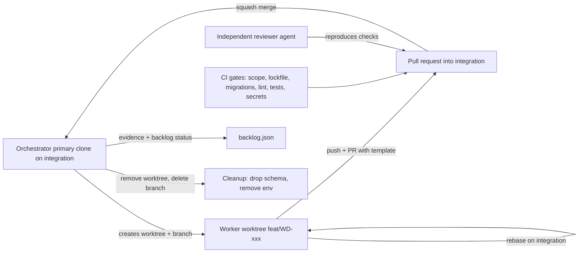
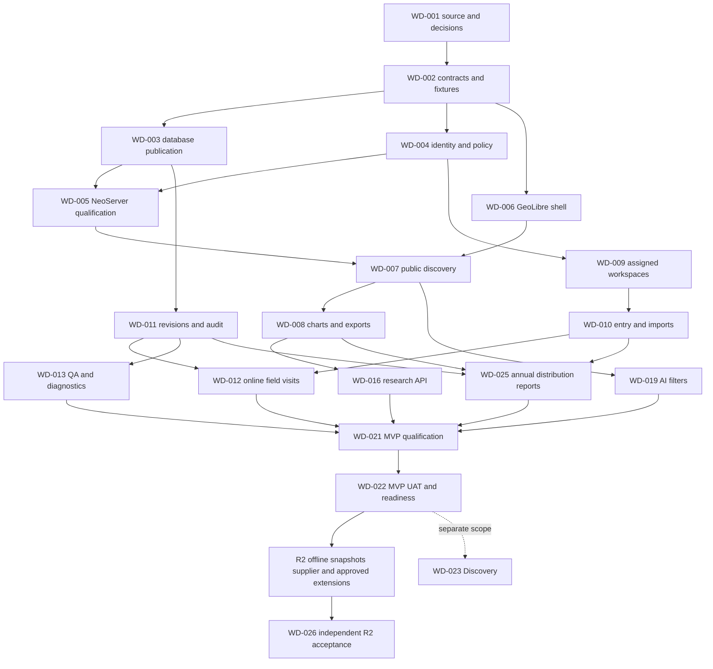

# AI subagent development and testing plan

Utah Water Measurement Data Dashboard

October 21, 2026

## Delivery model

Build the product in small vertical slices that each join a persona screen to an authorized API, an explicit data contract, and independent acceptance evidence. A working mock-data prototype is the first slice. It does not establish production identity, live database connectivity, scientific correctness, or completion of the requirements below.

The linked [backlog](backlog.json) is the machine-readable task graph. `FR-001` through `FR-068` and `NFR-001` through `NFR-010` are the stable requirement identifiers in the [PRD](01-product-requirements.md). Its 31 tasks use stable IDs `WD-001` through `WD-026`, with `-R2` suffixes for five separated later-release work packages; test groups use `T-01` through `T-16`. `AT-FR-xxx` and `AT-NFR-xxx` identify planned acceptance scenarios, not executed tests. Mark a task complete only when its listed acceptance evidence exists, its dependencies pass, and a different agent or human has reviewed the result. Completing a demo must not automatically close production backlog tasks.

The September 2026 source is a draft with six personas, including Donna as a public/policy audience. Reconcile all six supplied Figma flows and preserve Donna's account-free path; her supplied starting node is `81:365`. Keep field engineer, automation engineer, regional engineer, and modeler as permission variants rather than automatically giving every engineer all privileges. [2026 requirements PDF, physical pages 1, 7-8, 13, 37-38](../../Updated%202026%20User-Centric_Design_Requirements_for_the_Water_Measurement_Data_Dashboard.pdf)

## Agent contracts and edit boundaries

The orchestrator owns the task graph, scope, integration branch, and evidence index. It supplies the same approved contracts to every agent and resolves conflicting assumptions before a dependent merge. Once the production repository exists, every agent works under the mandatory branch and worktree strategy in the next section: one task, one branch, one worktree, one writer. Until the repository is bootstrapped, assign distinct files; shared filesystem access is not permission to edit another agent's scope.

| Agent | Assigned work | Allowed writes in a proposed production repository | Required handoff |
| --- | --- | --- | --- |
| Product and traceability | Persona journeys, acceptance criteria, source reconciliation | `docs/product/**`, `docs/traceability/**` | Source page/node, FR IDs, scope and unresolved decisions |
| Contract and data | OpenAPI, JSON schemas, SQL migrations and publication views | `packages/contracts/**`, `database/**` | Versioned schemas, fixtures, migration/rollback and data assumptions |
| Identity and policy | Sessions, entitlements, owner/assignment checks | `services/api/src/auth/**`, `packages/policy/**` | Allow/deny matrix, revocation behavior and negative tests |
| Spatial integration | NeoServer catalog/proxy and GeoLibre adapter | `services/geo-gateway/**`, `apps/web/src/map/**` | Captured capabilities, safe field inventory and spatial control-point evidence |
| Persona UI | Responsive role screens, accessible charts/tables | `apps/web/src/features/**`, `apps/web/src/components/**` | States/routes, keyboard evidence, FR IDs and screenshots |
| Workflows and sync | Corrections, visits, drafts, uploads, outbox | `services/api/src/workflows/**`, `apps/web/src/offline/**` | State diagrams, idempotency/conflict rules and event evidence |
| QA and accessibility | Independent tests and fixtures | `tests/**`, `fixtures/**` | Commands, environment, pass/fail artifacts and reproducible defects |
| Security reviewer | Threat review and adversarial validation | `docs/security/**`, `tests/security/**` | Findings with exploit steps, affected FR IDs and severity |
| Platform and operations | CI, runtime packaging, monitoring, backup drills | `.github/workflows/**`, `infra/**`, `ops/**` | Pinned artifacts, deploy/rollback runbook and recovery evidence |

These are bounded work roles, not a requirement to run nine agents simultaneously. With four concurrent slots, reserve one for the orchestrator and run at most three workers. Schedule independent UI, data, and test work together; schedule policy and its independent security review on separate agents. The same agent must not implement a control and provide its sole approval.

The contract agent proposes shared API/type changes; the orchestrator accepts a version before consumers update. Each task has a single writer. A second agent can read and review but sends a patch proposal or defect to the owner. Never have agents concurrently edit a lockfile, shared schema, route registry, or migration number. The orchestrator integrates dependency and contract updates sequentially.

## Repository topology, branches, and worktrees

This section is the mandatory Git workflow for the production repository. It applies from WD-001 onward; agents may not merge or push on their own authority outside it. The delivered `output/prototype` repository is the synthetic starting point only: WD-006 imports it into the production monorepo as the initial `apps/web` source, and the prototype repository is then retired from active development.

### Repository layout

One monorepo, `utah-water-dashboard`, hosted on the DWRi-approved Git service. The directory tree is exactly the write-scope vocabulary used by the agent table and `backlog.json`, so a branch's changed paths can be mechanically checked against its task's `write_scopes`:

```text
utah-water-dashboard/
  apps/web/            # persona UI, GeoLibre adapter, offline capture
  packages/contracts/  # OpenAPI, JSON schemas, generated types
  packages/policy/     # entitlement evaluation engine
  services/api/        # water domain backend (auth, workflows)
  services/geo-gateway/# same-origin spatial route allowlist and proxy
  database/            # migrations, publication views, qualification queries
  tests/  fixtures/    # independent QA suites and deterministic fixtures
  infra/  ops/         # deployment, monitoring, runbooks, backup drills
  docs/                # product, traceability, security, decisions
  .github/             # workflows, CODEOWNERS, PR template
```

### Branch taxonomy

All branch names are lowercase ASCII letters, digits, and hyphens, at most 60 characters, and carry the task ID whenever one exists.

| Branch pattern | Who may create/push | Base | Merged into | Purpose |
| --- | --- | --- | --- | --- |
| `main` | Nobody directly; protected | - | - | Release history only. Signed tags `vX.Y.Z`. Production deploys happen from tags. |
| `integration` | Orchestrator only (via PR merges); protected | `main` | `main` at release | Convergence branch for all task work; every gate in this plan runs here or against PRs into it. |
| `feat/<WD-ID>-<slug>` | The single worker agent owning that task | `integration` | `integration` | One vertical slice; linear history via rebase, no internal merge commits. |
| `fix/<WD-ID>-<defect>` | The task's owning worker | its `feat/` branch | the same `feat/` branch | Defects found by independent review, before or after PR open. |
| `test/<T-ID>-<slug>` | QA/accessibility and security reviewer agents | `integration` | `integration` | Independent tests, fixtures, and adversarial checks; never contains feature code. |
| `contract/v<N>-<slug>` | Contract and data agent | `integration` | `integration` | Shared OpenAPI/schema/migration proposals the orchestrator accepts before consumers rebase. |
| `chore/deps-<date>` | Orchestrator only | `integration` | `integration` | The only branches that may change `pnpm-lock.yaml` or pinned images. |
| `release/v<X.Y>` | Platform and operations agent | `main` | `main` | Release hardening and rollback preparation. |
| `hotfix/v<X.Y.z>` | Platform and operations agent | the release tag | `main`, then `integration` | Emergency fix; requires the same review gates, expedited. |

Agents never push to `main` or `integration` directly, never rewrite their branch after the orchestrator has merged it, and use `--force-with-lease` only on their own unmerged `feat/`/`test/` branch.

### Worktree conventions

Parallel agents never share a checkout. The orchestrator keeps the primary clone checked out on `integration`, and each running task gets one linked worktree in a sibling directory:

```text
~/work/utah-water-dashboard/                        # orchestrator clone, on integration
~/work/utah-water-worktrees/
  wd-006-geolibre-shell/
  wd-004-identity-policy/
  wd-002-contracts-fixtures/
```

Rules:

1. **One branch, one worktree, one writer.** A worktree is created for exactly one task ID and destroyed when that task merges. Two agents never work in the same worktree, and no agent edits another worktree's files, even read-write filesystem permissions allow it.
2. **The orchestrator works only in the primary clone**, only on `integration`, release, or chore branches, and is the only agent that merges pull requests, updates `backlog.json` task status/evidence, and renumbers migrations at merge time.
3. **Per-worktree dependencies.** Each worktree runs `pnpm install --frozen-lockfile` into its own `node_modules` against the shared pnpm store. A worker cannot change the lockfile, so installs fail loudly if a branch drifted from the accepted contract.
4. **Per-worktree test isolation.** Integration tests create an ephemeral, branch-named PostgreSQL schema or database (for example `wd_006_geolibre`) and a disposable NeoServer container. Tests never share state across worktrees, and the cleanup step drops the schema when the worktree is removed.
5. **No secrets in any worktree.** Environment files are gitignored, hold only secret references, and are created from the secret manager per worktree and deleted at cleanup. No real credentials, personal data, or unpublished measurements enter any worktree or any agent prompt.

### Concurrency and scheduling

The repository enforces the execution policy in `backlog.json`: three concurrent workers plus the reserved orchestrator. The orchestrator schedules only tasks whose `depends_on` are already merged into `integration`, gives each its worktree, and never runs two tasks with overlapping `write_scopes` simultaneously. A representative steady-state allocation:

| Slot | Occupant | Example branches active |
| --- | --- | --- |
| Orchestrator (primary clone) | Merge, renumber, evidence, backlog status | `integration`, `chore/deps-2026-11-02` |
| Worker 1 | `persona_ui` | `feat/WD-006-geolibre-shell` |
| Worker 2 | `contract_data` | `contract/v1-observation-revisions` |
| Worker 3 | `qa_accessibility` | `test/T-02-policy-matrix` |

When a worker blocks on a contract or dependency decision, its worktree is parked (see lifecycle below) and the slot moves to the next ready task rather than idling.

### Commits and pull requests

Every commit uses the Conventional Commits form plus mandatory trailers, so evidence can be traced mechanically from any commit to its requirement, tests, and agent:

```text
feat(entry): stage bulk paste validation with row-level errors

Adds the staged import previewer and per-row scope checks for FR-021.

Task: WD-010
Refs: FR-021, FR-020
Tests: T-07
Agent: workflow_sync
Evidence: tests/fixtures/imports/full-year-daily.json
```

Each pull request into `integration` uses the repository's PR template (copy retained at [templates/pull-request-template.md](templates/pull-request-template.md)) and must state the task ID, requirement IDs, executed commands with results, evidence artifacts, deviations from the allowed write scope, and unresolved decisions. CI rejects a PR when:

- changed paths fall outside the task's `write_scopes` (except `test/` branches and explicitly enumerated shared-file exceptions),
- `pnpm-lock.yaml` changed on a non-`chore/deps` branch,
- a migration file predating `integration` was modified rather than appended,
- commit trailers are missing the task or agent identity,
- lint, typecheck, unit, contract, affected integration, or secret-scan gates fail.

Independent review is a merge-blocking status: a different agent (or human) reproduces the task's checks per the reviewer packet before approval. The implementer can never be the sole approver of its own branch.

### Shared-file arbitration

- **Lockfile and pinned images**: workers request dependencies as defects to the orchestrator; only `chore/deps-<date>` branches change `pnpm-lock.yaml`, pinned container digests, or the GeoLibre/NeoServer version pins, and they merge alone, never alongside feature work.
- **Database migrations**: files are named `V<yyyyMMddHHmm>__<wd-id>_<slug>.sql`, making cross-branch collisions unlikely and diffable. Migrations are append-only once merged into `integration`; the orchestrator resolves any numbering overlap at merge time and the contract agent re-reviews the reordered sequence.
- **Contracts**: OpenAPI, JSON schemas, route registries, and the policy matrix change only on `contract/v<N>` branches. Consumers rebase after the orchestrator accepts a version; consumer branches never edit contract files directly.
- **`backlog.json`**: the orchestrator's primary clone is its single writer. Workers report status in PRs and handoffs; they never edit the backlog.

### Sync and merge cadence

Workers rebase onto `origin/integration` at the start of every working session and immediately after any dependency or contract branch merges. Conflicts inside the worker's own `write_scopes` are resolved by the worker; conflicts on shared files go to the orchestrator, which arbitrates before either branch proceeds. The orchestrator merges accepted PRs with squash merges (preserving trailers in the squash message), records the PR number and merge SHA in the task's `evidence` array, and only then marks the task complete in `backlog.json`.



### Worktree lifecycle and cleanup

Create, work, hand off, merge, destroy. A worktree must not outlive its task.

```bash
# Orchestrator: one-time bootstrap
git clone <git-host>/utah-water-dashboard.git ~/work/utah-water-dashboard
cd ~/work/utah-water-dashboard
git switch -c integration origin/main
git push -u origin integration

# Orchestrator: start a task for a worker
cd ~/work/utah-water-dashboard
git fetch origin
git worktree add ../utah-water-worktrees/wd-006-geolibre-shell \
  -b feat/WD-006-geolibre-shell origin/integration

# Worker: inside the worktree
cd ~/work/utah-water-worktrees/wd-006-geolibre-shell
pnpm install --frozen-lockfile
# ... develop; commit with trailers ...
git fetch origin && git rebase origin/integration   # daily sync
git push -u origin feat/WD-006-geolibre-shell
# open the PR into integration using the template

# Orchestrator: after approval and gates pass
gh pr merge <number> --squash --delete-branch
git worktree remove ../utah-water-worktrees/wd-006-geolibre-shell
git worktree prune
```

Cleanup checklist on every worktree removal: stop dev servers and watchers, drop the branch-named test schema/container, delete the local environment file, and verify `git worktree list` shows no stale entries. Parked worktrees with no activity for five working days are reported by the orchestrator and either resumed or removed; `git worktree prune` runs as part of weekly hygiene. On Windows, worktrees live on the same drive as the primary clone and use Git Bash POSIX paths for all scripting; the same commands run unchanged on POSIX CI hosts.

### Branch protection and audit

`main` and `integration` require pull requests, passing status checks, and a non-implementer approval; direct pushes, force pushes, and branch deletion are disabled for every account and agent. CODEOWNERS maps each directory to its owning agent role so review requests route automatically. Release tags are signed, and each release manifest records the tag, commit SHA, dependency lockfile hash, and container digests actually deployed. Commit and PR history — with their `Task`/`Refs`/`Tests`/`Agent` trailers — is part of the delivery evidence chain and is retained with the audit record.

## Dependency graph and delivery phases



The diagram shows the critical path; `backlog.json` includes dependencies for stewardship, alerts, summaries and support. MVP qualification (WD-021) and UAT/readiness (WD-022) depend only on MVP implementation tasks. The R2 gate (WD-026) separately qualifies offline sync, decision/finalized snapshots, flexible periods, recurring issue trends, rating history, voice notes, asset transfers, approved as-of/WCAT work and supplier reporting. FR-050 and FR-067 remain separate Discovery in WD-023. The graph has no R2 or Discovery dependency in the MVP gate's transitive closure. Baseline/source tasks may reference later requirements to document decisions without implementing them.

| Phase | Concrete increment | Exit evidence |
| --- | --- | --- |
| P0 Qualification | Source baseline, Figma reconciliation, actual database/identity inventory, safe publication model and protocol spike | Approved contract; verified extension inventory; known Utah control points; direct denied protocol requests |
| P1 Public and read-only users | Public map and profiles, validated filters, charts, quality context, exports, saved preferences and documented researcher access | Reproducible discovery/export results; account-free path; no restricted bytes in any response |
| P2 MVP operations | Assigned commissioner/engineer workspaces, bulk reading entry, site metadata, correction revisions/audit and online visits | Assignment negative tests; scientific golden values; revision/conflict proofs |
| P3 MVP governance and acceptance | Stewardship, QC rules/subscriptions, annual distribution reports, summaries and onboarding | Data owner UAT, independent security/accessibility review, restoration and rollback drill |
| P4 R2 | Offline sync, asset transfers, finalized decision/report snapshots, rating history, recurring issue trends, supplier reporting and approved as-of/voice/WCAT extensions | Separately agreed contracts, T-09 offline evidence and independent R2 acceptance |
| Discovery | Advanced site/access-point and expanded right-network/OpenET/transaction interfaces | Source availability, explicit integration contracts and a separately accepted scope |

P0 must establish whether the existing GCP PostgreSQL service actually supports TimescaleDB. Cloud SQL permits only listed extensions and its current list omits TimescaleDB. A self-managed instance on GCP is a different case. This is a deployment qualification gate, not an instruction to replace an existing database. [Google Cloud extension policy](https://docs.cloud.google.com/sql/docs/postgres/extensions)

## Source and context prompt templates

Every agent starts with a bounded context packet. Give it approved excerpts and exact locators; keep the full source files available for verification. Figma nodes identify intended flows only after they can be read. Do not assert visual parity for an inaccessible frame.

```text
Task: WD-xxx <one concrete outcome>
Requirements: FR-xxx, FR-yyy
Approved sources: <PDF physical page / exact Figma node / pinned upstream revision>
Contract version: <OpenAPI hash / policy matrix hash / data schema revision>
Inputs: <synthetic fixture IDs, approved paths, dependency commits>
Allowed writes: <exclusive file paths>
Out of scope: <dependent or deferred work>
Acceptance: <observable behavior and independent test IDs>
Constraints: no live credentials or personal data; no production changes;
            do not weaken authorization to make fixtures pass.
Return: changed files, FR mapping, commands/results, artifacts, decisions and blockers.
```

Reviewer packet:

```text
Review WD-xxx at <commit>. Do not approve from the implementer's summary alone.
Read <contract> and <FR acceptance criteria>; reproduce T-xx with <fixture seed>.
Probe direct URLs, altered identifiers, cache behavior and the empty/error states.
Report: pass/fail, exact evidence, severity, reproduction and untested assumptions.
Only edit your assigned review/test paths; send implementation defects to its owner.
```

Handoffs include a concrete `status`, dependency revisions, file list, tests actually executed, results, artifacts, unresolved decisions, and the next owner. Do not report a proposed command as a completed check. A source or tool failure is recorded as an evidence gap and does not silently become an assumed capability.

## Test data and scientific invariants

Use deterministic fixtures with a fixed clock and random seed. Start with two distribution systems, one subgroup, two owners, two engineers assigned to different systems, one commissioner/deputy pair, one steward, one researcher and an anonymous user. Include six synthetic stations: public telemetry; public manual; restricted owner; internal diagnostic; inactive; and proposed. Give one public and one private station the same display name to catch identifier mistakes. Include a restricted field/photo on a public station, because row visibility alone is insufficient.

A short time series must contain zero, null, negative and out-of-range readings; irregular intervals; duplicate timestamps; an explicit gap; UTC timestamps spanning a Utah daylight-saving transition; observed versus estimated values; raw, provisional and best-available versions; and two later corrections with different reasons. Add one source outage, one late arrival, one device replacement and two rating-curve periods. Use generated geometry at known Utah coordinates and a second latitude where a WMS axis-order error becomes obvious. Larger load fixtures are generated from the same seed and labeled synthetic.

Golden calculations are approved by the measurement data owner: unit conversions, cumulative volume from irregular flow samples, missing-interval behavior, aggregation boundaries, and rating-curve effective periods. Preserve missing data as missing; do not interpolate or coerce null to zero without an explicit method and qualifier. Compare numerical results to reviewed expected values with documented tolerances. [2026 requirements PDF, physical pages 40-44, 67-68](../../Updated%202026%20User-Centric_Design_Requirements_for_the_Water_Measurement_Data_Dashboard.pdf)

## Verification matrix

Run the rows against the enabled requirements in each release. T-09 and the R2 portions of T-06/T-13/T-15 qualify the separate R2 gate; they do not require unimplemented R2 functions to pass before MVP acceptance. Shared policy, cache and regression checks apply to both releases.

| Test | Required checks | Evidence |
| --- | --- | --- |
| T-01 Requirements and contract | All FR IDs resolve; source/priority/status explicit; OpenAPI and schemas validate; mock/live provider conform | Traceability report, schema diff, contract hash |
| T-02 Policy unit | Role x action x scope x visibility; missing grants deny; engineer variants; deactivated users; unknown identifiers | Parameterized deterministic allow/deny results |
| T-03 API authorization | Anonymous, owner A/B, commissioner system A/B, engineer A/B, steward; altered IDs/body; CSRF; session expiry/revocation; token scope/rotation | HTTP status and redacted response assertions |
| T-04 PostgreSQL integration | Migrations, publication safe fields, unique IDs, SQL constraints, indexes/query plans, transaction rollback and pool isolation | Disposable database logs and query-plan review |
| T-05 Protocol and spatial | Features paging/bbox/datetime; WFS explicit GeoJSON; WMS GetMap/GetFeatureInfo; MVT decode; `z/y/x`, source-layer and CRS/axis control points | Capabilities/OpenAPI snapshots and known coordinate checks |
| T-06 Data and revisions | Raw immutable; authorized tombstone retains history; correction reason/qualifiers; optimistic lock; indefinite best-available revisions; stable finalized report snapshot | Golden values, before/after revisions and audit chain |
| T-07 Bulk inputs | Full year of daily rows, headers/units/dates, duplicate submission, invalid cell preview, atomic accepted batch behavior, CSV formula neutralization | Import fixture and exact row error results |
| T-08 Cache and privacy | Owner/cohort A warms a tile/feature/export; B and public cannot receive it; publish revision invalidates external-write stale cache; revoked grants blocked even with warm caches | Decoded PBF/GeoJSON and cache/header assertions |
| T-09 Offline sync | Capture offline; reload; attachments; reconnect; idempotency; crash after server commit before acknowledgement; conflicting edit; expired/revoked grant; visible retry/quota failure; sign-out cleanup | Browser storage and server event sequence, no duplicates |
| T-10 Persona E2E | Public discover; steward assign/review; commissioner bulk entry/report; engineer correct/visit; owner favorite/report; scientist filtered export | Playwright run/video, role-specific assertions |
| T-11 Accessibility | Keyboard map alternatives and table; focus order/dialog return; screen reader labels/live status; non-color quality meaning; contrast; 200% zoom; responsive layout | Automated axe plus manual keyboard/screen reader record |
| T-12 Performance | Cold/warm map, first usable page, bbox pan, chart and export queues under stated load; DB saturation and rendering limits | Repeatable test profile, p50/p95 and resource traces |
| T-13 AI behavior | NLP/manual query equivalence; inspectable filters; unknown terms require clarification; prompt injection cannot expand grants; no generated SQL execution; transcription remains editable draft | Curated evaluation set, expected validated AST and denial tests |
| T-14 Operations | Single NeoServer writer, restart, quiesced backup/restore, secret recovery, cache refresh failure, telemetry/audit-loss alert, rollback | Drill log, restored checksum and timed recovery |
| T-15 Alerts and reports | Threshold/rate/persistence/missing/zero checks; independent failure isolation; digest timezone/weekend rules; ownership; report validation and immutable submitted PDF | Fixed-clock schedules, event dedupe, approved report fixture |
| T-16 Dependency and supply chain | Locked versions/integrity; actual GeoLibre headless API import/build; no secrets in bundle/source maps; dependency/license findings | Lockfile, build, inventory and scan artifact |

Negative security tests call the service and each permitted protocol directly, including collection listings, queryables, feature info, tiles, bulk downloads and cached variants. A hidden UI action or a client-side filter never counts as a successful authorization test. NeoServer workspace roles do not establish owner-specific entitlements. Test owner-specific data through the domain backend and cohort/public map publications separately. [NeoServer authentication](https://github.com/tobilg/neoserver/blob/main/docs/authentication.md)

NeoServer's external-database writes need a controlled cache refresh; its single-store deployment requires one active writer. T-08 and T-14 therefore block production acceptance even when the UI appears correct. [NeoServer tile cache](https://github.com/tobilg/neoserver/blob/main/docs/tile-cache.md), [deployment](https://github.com/tobilg/neoserver/blob/main/docs/deployment.md)

## Commands and CI gates

The delivered prototype uses pnpm with `pnpm-lock.yaml`. Its `package.json` defines these scripts. Execute them from `output/prototype`; use the documented Node/pnpm runtime. This list records available entry points and makes no assertion that this plan executed them.

```powershell
pnpm install --frozen-lockfile
pnpm test
pnpm run build
pnpm run dev
```

`test` currently invokes Node's test runner for `tests/policy.test.ts`, `tests/adapters.test.ts` and `tests/observations.test.ts`; `build` runs TypeScript checking then Vite. Clean CI preserves pnpm's frozen lockfile and the chosen package-manager version; do not generate a second lockfile with another installer. Dependency installation must fail visibly when the registry is unavailable. Do not substitute stub dependencies or relabel an unbuilt source tree as a validated runnable artifact.

The following are **proposed production scripts to implement**, not commands promised by the current prototype:

```text
pnpm run lint
pnpm run typecheck
pnpm run test:unit
pnpm run test:contract
pnpm run test:integration
pnpm run test:security
pnpm run test:e2e
pnpm run test:a11y
pnpm run test:performance
pnpm run test:ai-evals
```

Pull requests run formatting/lint/type checks, unit/contract tests, secret checks and the affected deterministic integration tests, together with the branch-scope, lockfile, migration-append and commit-trailer checks defined in the repository topology section. Disposable PostgreSQL/PostGIS and a pinned NeoServer container serve the integration suite; add a compatible Timescale image only after P0 confirms that deployment path. Feature, policy and schema changes require the affected negative tests. Run Chromium persona flows per PR and Edge/Firefox/WebKit compatibility plus manual Safari/iOS/Android checks before each release. WebKit coverage is useful but does not alone certify Safari on actual devices.

Run load, backup/restore, larger spatial fixtures and AI evaluation suites in a staging environment containing synthetic data. Record commits/image digests, database extension versions, browser versions, CPU/network profile, fixture seed and clock. A pass without that environment record is insufficient for a regression baseline.

Provisional acceptance targets for owner confirmation: first usable page and useful map within 3 seconds at p95; bounded chart within 2 seconds at p95; initial bbox feature response within 1 second at p95; no dropped edits in repeated interrupted sync; and no critical automated accessibility findings plus successful manual task completion. Benchmark against a defined reference profile, initially 10,000 visible station features, 100 concurrent sessions, a four-core desktop, a midrange phone and a 10 Mbps/100 ms network. These are proposed engineering targets, not performance facts from the source or the current prototype. Large export jobs use an acknowledged background job with progress rather than the interactive latency budget.

## Human ownership and release decisions

The DWRi product owner accepts persona scope, terminology and Figma differences. The measurement/data governance owner approves vocabularies, QC rules, formulas, correction authority, raw deletion/tombstone policy, publication classes and retention. Agency identity/security owners approve SSO, privileged access, revocation and the independent security findings. Operations owns secrets, capacity, backups, recovery and rollback. Representative commissioners, field engineers, water users, researchers and public/policy users complete task-based UAT.

Agents may implement and test in local/disposable environments. They do not deploy to production, connect to a live database, run destructive raw-data deletion, alter user grants, send notifications or publish private datasets without explicit authorization for that action and environment. Use synthetic/redacted data in agent context; never paste live credentials, personal information, internal gate codes or real unpublished measurements into prompts or logs. Keep secrets in the approved secret manager and supply only secret references to agents.

Release requires an approved scope and data policy; pinned dependencies/images; passed critical-path and negative tests; no unresolved high-severity security/data-integrity defects; reviewed accessibility results; a rehearsed backup/restore and rollback; named on-call owners; and an approved production change. Roll out read-only/public functions first, then a limited authorized operational cohort. Monitor denied requests, stale data, import/sync failures, audit loss and database pressure. Stop rollout when authorization, data integrity or recoverability evidence fails.

Point-in-time reconstruction, voice transcription, complete accounting models and expanded right-network/OpenET interfaces retain their own scope/acceptance decisions. SensorThings remains outside the baseline unless a verified client interoperability contract needs it; requesting GeoJSON alone is not such a requirement.
